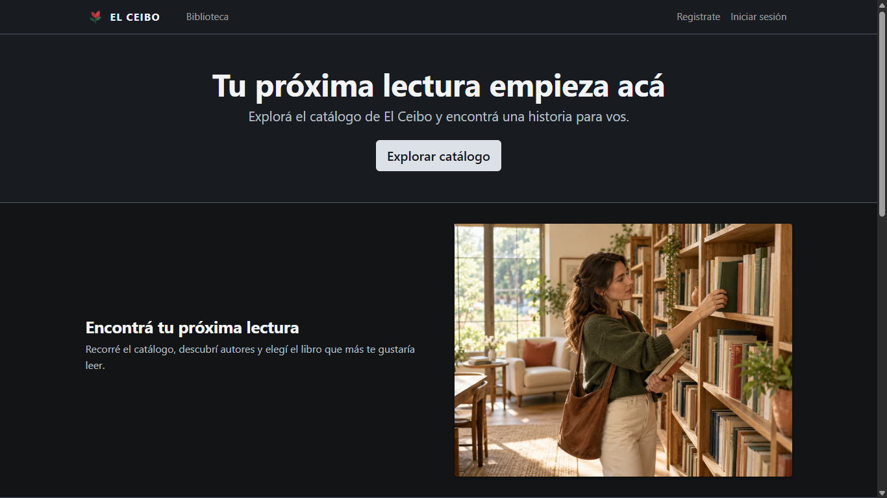
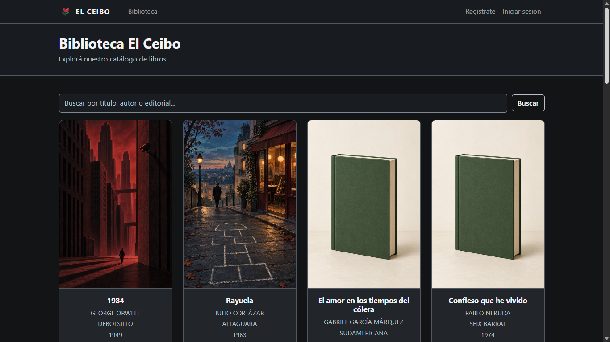
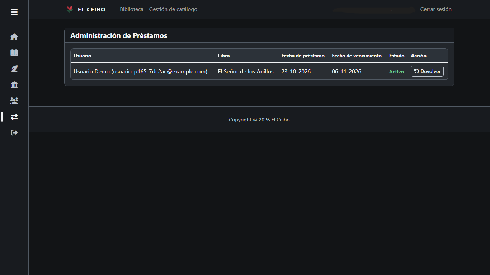
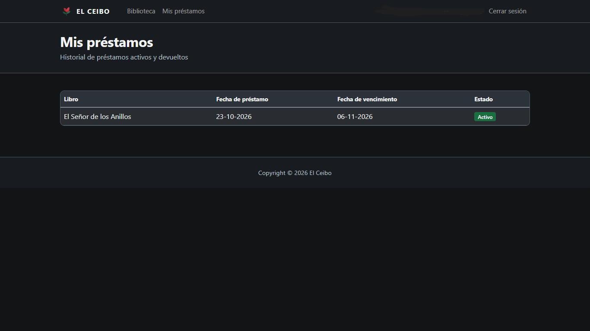
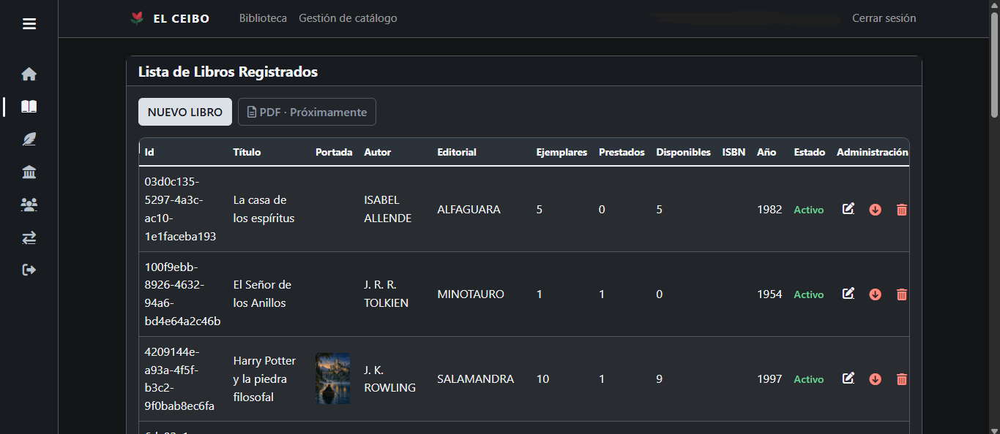
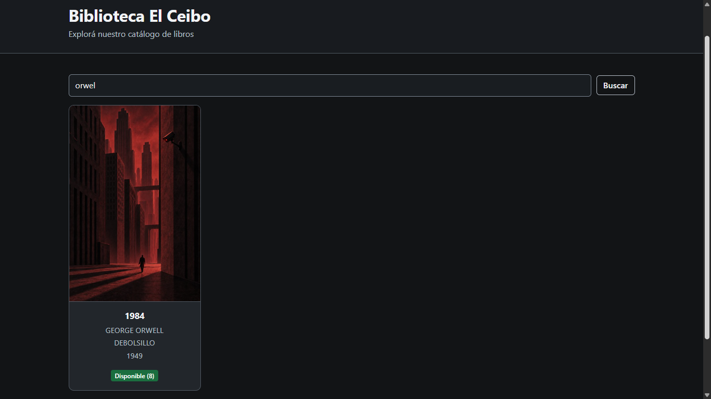
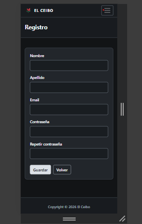

# Librería Web El Ceibo

Aplicación web para gestionar el catálogo de una librería y el **préstamo de libros** entre
usuarios registrados. Está hecha con **Java 8, Spring Boot, Spring Data JPA, MySQL, Flyway y
Thymeleaf**, con autenticación y autorización por rol (Spring Security).

Nació como proyecto académico en 2022 y fue retomada en 2026 para llevarla a un estado de
portfolio: esquema versionado con migraciones, seguridad revisada, control de concurrencia en las
operaciones críticas, tests automatizados y una demo con base separada.

> No es una aplicación productiva. Los límites conocidos están en [Límites y decisiones](#límites-y-decisiones).
> Documentación complementaria: [diagramas](docs/diagramas.md) y [defensa técnica](docs/DEFENSA_TECNICA.md).

## Capturas

Tomadas sobre la demo local (perfil `demo`, datos ficticios; los datos de la sesión se difuminaron).

| Inicio | Catálogo |
|---|---|
|  |  |
| **Préstamos (ADMIN)** | **Mis préstamos (USUARIO)** |
|  |  |

<details>
<summary>Más capturas</summary>







</details>

## Qué permite hacer

La interfaz usa un **tema oscuro** propio, con menú lateral de gestión. La interfaz incorpora
adaptación responsive.

Existe **acceso anónimo** (sin sesión) y **dos roles de seguridad**: `USUARIO` y `ADMIN`.

### Acceso anónimo (sin sesión)
- Ver el inicio y **explorar el catálogo** de libros, con búsqueda por título, autor o editorial.
- Registrarse como usuario e iniciar sesión.

### Usuario (`USUARIO`)
- Explorar el catálogo y ver disponibilidad de cada libro.
- **Solicitar un préstamo** de un libro disponible.
- Consultar **Mis préstamos**: libro, fecha de préstamo, fecha de vencimiento y estado (activo o devuelto).
- Cerrar sesión (logout por `POST`).

### Administrador (`ADMIN`)
- **Gestión de catálogo**: alta, baja lógica, reactivación, modificación y eliminación de libros, autores y editoriales; carga de portadas.
- Gestión de usuarios (listado, modificación, baja/alta y eliminación).
- **Préstamos**: listado completo con usuario, libro y vencimiento, y **registro de devoluciones**.

El acceso está restringido por rol tanto en la navegación como en el backend: escribir una URL
manualmente no da acceso a lo que el rol no permite (devuelve la página 403, o redirige al login
si no hay sesión).

## Reglas de préstamo

- Un usuario puede tener como máximo **3 préstamos activos**.
- No puede solicitar dos veces el mismo libro mientras tenga uno activo.
- El préstamo vence a los **14 días**.
- Solo se prestan libros activos con ejemplares disponibles; los usuarios dados de baja no pueden solicitar.
- La devolución repone el ejemplar; un préstamo ya devuelto no puede devolverse de nuevo.
- Las operaciones son transaccionales y usan bloqueo pesimista para que dos solicitudes simultáneas
  no sobrepasen el stock (ver [Arquitectura](#arquitectura)).

## Tecnologías

| Área | Tecnología |
|---|---|
| Lenguaje | Java 8 |
| Framework | Spring Boot 2.7.18 (Web, Data JPA, Security, Thymeleaf) |
| Persistencia | Hibernate 5.6 / JPA, MySQL, Connector/J 8.4.0 |
| Migraciones | Flyway 8.5.13 (V1–V4); Hibernate en modo `validate` |
| Seguridad | Spring Security 5.7, BCrypt (con control de 72 bytes), CSRF activo |
| Vistas | Thymeleaf 3 + Bootstrap 5 (CSS del tema incluido; resto por CDN) |
| Build | Maven (wrapper `mvnw` incluido) |
| Tests | JUnit 5, Spring Test / MockMvc, Spring Security Test |

## Arquitectura

Capas clásicas MVC, con la lógica de negocio concentrada en los servicios:

- `controladores/` — rutas HTTP y mensajes de éxito/error para la vista.
- `servicios/` — reglas de negocio y transacciones (`ServiceLibro`, `ServicePrestamo`, `ServiceUsuario`, `ServicePortada`, …).
- `repositorios/` — Spring Data JPA, incluidas consultas con `PESSIMISTIC_WRITE`.
- `entidades/` — modelo de dominio.
- `config/` — seguridad, codificador de contraseñas y manejo de errores de carga de archivos.
- `seed/` — carga de datos demo (solo con el perfil `demo`).

**Transacciones y bloqueos.** Las operaciones de préstamo y de catálogo adquieren bloqueos
pesimistas siguiendo un orden consistente de adquisición, para reducir el riesgo de interbloqueos:

```text
Catálogo:  AUTOR → EDITORIAL → LIBRO → PORTADA
Préstamos: USUARIO → LIBRO     (solicitar)
           PRESTAMO → LIBRO    (devolver)
```

Esto no elimina por completo la posibilidad de un interbloqueo ni de una espera que termine en
timeout. En los servicios de préstamos y de libros (que incluye las altas y bajas de autor y
editorial que afectan libros), un fallo de bloqueo pesimista (`PessimisticLockingFailureException`)
se captura y se informa con un mensaje de dominio ("Intente nuevamente") en lugar de un error 500,
y la transacción se revierte. Otros errores de base de datos no están cubiertos por esa captura.
Ver los diagramas en [`docs/diagramas.md`](docs/diagramas.md).

## Modelo de datos

Entidades: `Autor`, `Editorial`, `Libro` (con `Portada` opcional), `Usuario` y `Prestamo`.
Un libro pertenece a un autor (obligatorio) y puede tener editorial y portada; un préstamo une a un
usuario con un libro y su estado se deriva de la fecha de devolución (sin fecha = activo).
El esquema se gestiona exclusivamente con migraciones Flyway:

| Migración | Contenido |
|---|---|
| V1 | Línea base del esquema existente |
| V2 | ISBN bibliográfico (`VARCHAR(13)`, único, nulo permitido) |
| V3 | Restricciones de integridad de libros (autor obligatorio, portada única, título+autor único) |
| V4 | Ciclo de vida del préstamo (estado derivado de la devolución) |

## Seguridad

- Roles `ADMIN` y `USUARIO`; reglas por ruta en `SecurityConfig` (lo no listado exige sesión). Las
  reglas de ruta exacta usan `mvcMatchers`, de modo que una barra final no evita el control de rol.
- Contraseñas con BCrypt. BCrypt solo considera los primeros 72 bytes (UTF-8) de la clave, por lo
  que un envoltorio (`BCrypt72BytePasswordEncoder`) **rechaza las contraseñas que superan ese
  límite**: al registrarlas lanza un error y al autenticar devuelve "no coincide". No las trunca
  ni las preprocesa. Este control compensa CVE-2025-22228 (aviso de Spring del 19/03/2025): la
  versión usada, Spring Security 5.7.11, está dentro del rango afectado y su corrección (5.7.16)
  solo se ofrece con soporte comercial, por lo que la aplicación no la incorpora. Es una mitigación
  de la aplicación, no una corrección de la biblioteca: un escaneo de dependencias seguirá
  señalando ese aviso. Hay tests del envoltorio y una regresión del login completo con una clave de
  exactamente 72 bytes (autentica) y el mismo prefijo más un carácter (se rechaza).
- **CSRF activo**; el cierre de sesión es `POST /logout`.
- **Cabeceras de seguridad:** `SecurityConfig` activa `HeaderWriterFilter.setShouldWriteHeadersEagerly(true)`,
  el workaround que indica el aviso oficial de CVE-2026-22732 (Spring Security 5.7.21 y anteriores:
  las cabeceras podrían no escribirse; la corrección 5.7.22 solo se ofrece con soporte comercial). Es
  un control compensatorio, no una corrección de la biblioteca, que sigue en 5.7.11. Con él, las
  cabeceras de seguridad se escriben aunque la aplicación fije su propio `Cache-Control`; una cabecera
  ya escrita no puede quitarse después. Se comprobó con tests y sobre el JAR (ver Tests).
- Páginas de error propias (403, 404, 500) con mensaje genérico, sin detalles técnicos.
- Sin credenciales en el repositorio: la configuración se toma del entorno.

## Cómo ejecutarla

Requisitos: **JDK 8** y **MySQL**. No hace falta instalar Maven: se usa el wrapper. El proyecto se
validó en Windows.

### Ejecución normal

1. Crear una base MySQL vacía (por ejemplo `libreriaweb`) con `utf8mb4`.
2. Exportar `DB_URL`, `DB_USERNAME` y `DB_PASSWORD` en el entorno, o copiar
   `application.properties.example` como `application-local.properties` (ignorado por Git) y
   activar el perfil `local`.
3. Ejecutar:

   ```bash
   ./mvnw spring-boot:run
   ```

4. Abrir la aplicación en el navegador. El proyecto no fija `server.port`: confirmá la dirección y el
   puerto en el log de arranque (`Tomcat started on port(s): …`).

Flyway crea el esquema al primer arranque.

### Modo demo (datos de ejemplo)

El perfil `demo` usa una base **separada y descartable llamada `libreriaweb_demo`** y carga datos
de ejemplo de forma idempotente. Su arranque y carga inicial fueron verificados, también con el JAR
ejecutable (ver Tests). Desde un clon limpio de `ac4c77e` se verificó el empaquetado con tests, pero
el JAR de ese clon no se ejecutó.
Variables necesarias (solo nombres):

- `DEMO_ADMIN_MAIL`, `DEMO_ADMIN_PASSWORD`, `DEMO_USUARIO_MAIL`, `DEMO_USUARIO_PASSWORD` (sin valor por defecto: si faltan, la aplicación no arranca).
- Opcionales: `DEMO_DB_HOST`, `DEMO_DB_PORT`, `DEMO_DB_USERNAME`, `DEMO_DB_PASSWORD` (por defecto `localhost`, `3306`, `root` y contraseña vacía).

Con la base `libreriaweb_demo` creada y vacía (nada la crea automáticamente):

```bash
SPRING_PROFILES_ACTIVE=demo ./mvnw spring-boot:run
```

`demo` es la **opción mínima**: no requiere `application-local.properties` ni el perfil `local`. No
combinarlo con `local`: ese perfil apunta a la base normal y la guarda de la demo aborta el arranque.

Datos iniciales: **17 libros, 14 autores, 12 editoriales**, 2 usuarios demo y 1 préstamo de ejemplo.
**Guardas:** el nombre de la base demo está fijo en el código y, con el perfil `demo`, el arranque
aborta si la conexión no apunta a `libreriaweb_demo` (primero se valida la URL y, antes de cargar
datos, el catálogo real de la conexión). Es una salvaguarda frente a errores de configuración, no
una protección absoluta: no sustituye el cuidado con las credenciales ni con las variables de
entorno del proceso.

## Tests

La suite automatizada cubre: servicios (libros, préstamos, usuarios), concurrencia de catálogo y
préstamos, seguridad por rol y CSRF por MockMvc, navegación renderizada por rol, la guarda y el
seeder de la demo, y el codificador de contraseñas.

```bash
./mvnw test
```

> ⚠️ Los tests **recrean** (DROP + CREATE) las bases `libreriaweb_testsuite` y
> `libreriaweb_demo_testsuite`. Sus guardas impiden usarlas contra otra base, pero conviene no
> tener datos propios en esos nombres. Requieren MySQL local activo.

Evidencia disponible, por tipo (no se suman entre sí):

- **Suite completa vigente:** `./mvnw -ntp clean package` con tests, sin perfil demo, sobre
  `libreriaweb_testsuite` y `libreriaweb_demo_testsuite`: **228 tests en 17 clases, 0 fallos, 0
  errores, 0 omitidos, BUILD SUCCESS**. Ejecutada sobre el árbol de trabajo previo al commit
  `ac4c77e`, que incorpora las correcciones de plantillas y cabeceras. El total de 228 se verificó
  sumando los reportes de surefire; BUILD SUCCESS lo aportó el autor al leer la salida (el código
  de salida original de Maven no se recuperó). Incluye la regresión de login con 72 bytes y 6
  tests nuevos (fragmentos Thymeleaf y cabeceras de seguridad).
- **Repetición en clon limpio de `ac4c77e`:** una nueva corrida de `clean package` con las mismas
  condiciones dio 228 tests en 17 clases, 0 fallos, 0 errores, 0 omitidos (suma de surefire) y
  generó el JAR. En esa corrida no se recuperó el resultado final de Maven (ni «BUILD SUCCESS» ni
  el código de salida). Es la misma suite, no una suma. Los 29 recursos de texto que difieren en
  bytes entre ese JAR y el JAR probado por HTTP son idénticos al normalizar solo CRLF/LF; ninguna
  clase difiere. El JAR del clon no se ejecutó.
- **Evidencias históricas, que no se suman a la anterior:** suite de 221 tests en 15 clases (antes de
  la regresión de login) y corrida focalizada de `CsrfProtectionMockMvcTest` con 17 tests; ambas
  quedan incluidas en los 228.
- **JAR ejecutable verificado (Windows):** el JAR empaquetado en esa misma corrida arrancó con el
  perfil `demo` en una instancia MariaDB aislada (puerto 3307, `libreriaweb_demo`): Flyway V1–V4
  desde un esquema vacío, carga inicial del seeder y comprobación HTTP: páginas públicas y estáticos
  200, rutas protegidas redirigen al login, cada rol (`ADMIN`, `USUARIO`) accede solo a lo suyo
  (200 / 403) y todas las respuestas llevan `nosniff`, `X-Frame-Options: DENY` y `Cache-Control:
  no-store`. Fue solo lectura y control de acceso: no se probaron altas, bajas ni préstamos por el
  JAR. Los tests MockMvc corren desde `target/classes` y no detectaron que todas las páginas fallaban
  con error 500 dentro del JAR; por eso hay ahora una comprobación específica de las plantillas
  (`TemplateFragmentReferencesTest`, que empaqueta las plantillas en un JAR temporal) y
  `scripts/smoke-jar-demo.ps1` para el JAR real.
- Comprobaciones HTTP sobre la demo y pruebas manuales del flujo principal: ver
  [`docs/DEFENSA_TECNICA.md`](docs/DEFENSA_TECNICA.md). Las pruebas automáticas no validan el
  aspecto visual.

## Estado del proyecto

Hecho: empaquetado y `java -jar` contra la demo (ver Tests). Escaneos con herramientas dedicadas
(gitleaks y OSV-Scanner, repetidos sobre el clon limpio de `ac4c77e` sin hallazgos nuevos): dos coincidencias de gitleaks, ambas
contraseñas de prueba de un test, descartadas como falsos positivos justificados, y avisos de
dependencias clasificados uno por uno; dentro del alcance auditado no se encontraron secretos
reales ni evidencia de avisos explotables en la aplicación (no es una afirmación de ausencia). Spring Boot 2.7 y varias bibliotecas tienen avisos con
corrección solo comercial: son deuda declarada (CVE-2025-22228 y CVE-2026-22732 mitigados por
controles compensatorios; CVE-2026-40973, de un atacante local en el mismo host, es riesgo residual
aceptado solo para la demo local, sin extenderlo a un despliegue productivo).

Pendiente antes de publicar: nueva verificación si cambia el código tras `ac4c77e`; comprobación del renderizado de los diagramas Mermaid en GitHub (los cinco se renderizaron y
revisaron localmente; las capturas ya están incorporadas); recorrido
completo por teclado, diferido por decisión del autor (validado parcialmente en el login; no se
declara cumplimiento de WCAG).

## Límites y decisiones

- Sin notificaciones por email, multas, renovaciones ni reservas.
- Una sola instancia y una sola base; sin Docker, CI/CD ni despliegue productivo.
- Se permanece en Spring Boot 2.7 / Java 8; migrar a Spring Boot 3 queda fuera de alcance.
- Sin exportación PDF (los botones están deshabilitados con «PDF · Próximamente») y sin búsqueda en las listas de gestión; son mejoras futuras. La búsqueda del catálogo público funciona.
- Bootstrap (JS), Bootstrap Icons y Font Awesome se cargan desde CDN; ver [THIRD_PARTY_NOTICES.md](THIRD_PARTY_NOTICES.md).
- La base `libreriaweb` histórica no se migra automáticamente. Si se reutiliza una base con usuarios anteriores, las cuentas con claves de más de 72 bytes quedarían rechazadas hasta un restablecimiento administrativo.
- Imágenes: el logo, las portadas de ejemplo, las imágenes del inicio y la tapa neutra (`libro.jpg`) fueron generados con IA, según declara el autor; el detalle por archivo está en [THIRD_PARTY_NOTICES.md](THIRD_PARTY_NOTICES.md) §3. Las imágenes de `docs/img/` son capturas de la aplicación.

## Licencia

[Apache License 2.0](LICENSE) para el código propio y la documentación propia de El Ceibo. Los componentes de terceros conservan sus licencias y avisos ([THIRD_PARTY_NOTICES.md](THIRD_PARTY_NOTICES.md)). La procedencia de las imágenes generadas con IA se documenta por separado en ese mismo archivo (§3); esta licencia no declara derechos exclusivos del autor sobre ellas.

## Autor

**Lautaro Pavez** — [GitHub](https://github.com/lautaropavez)
