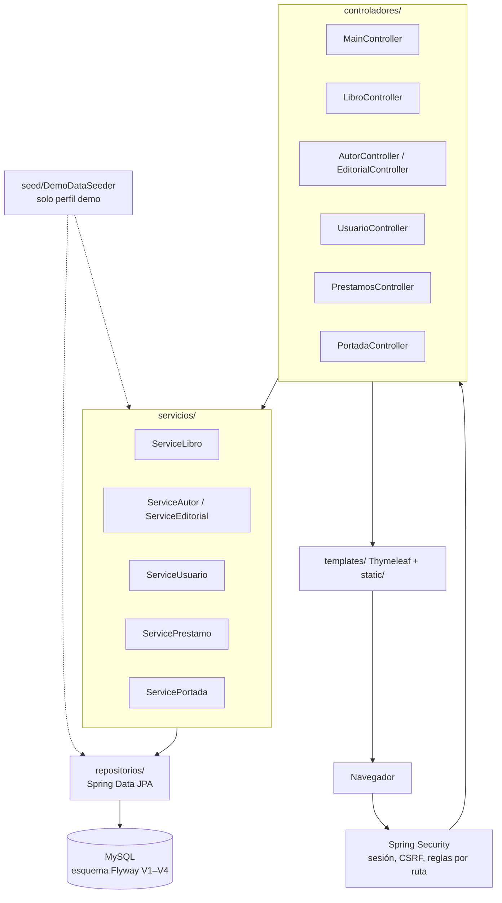
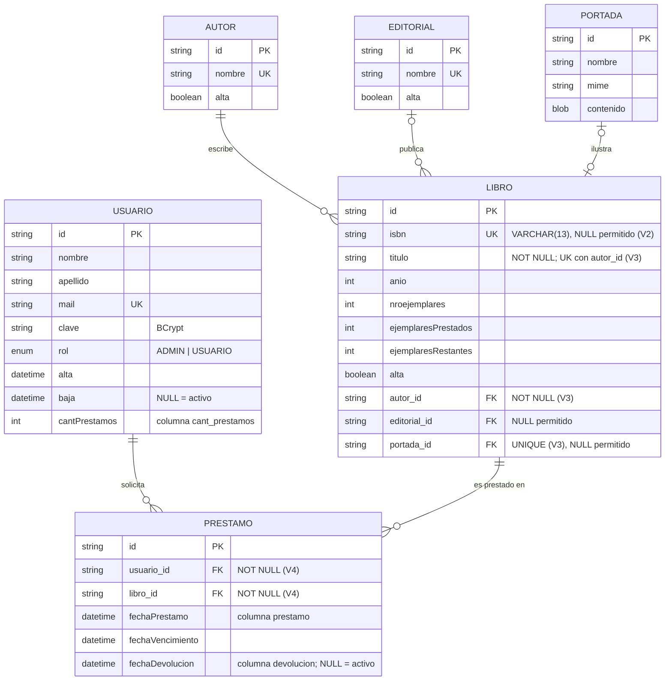
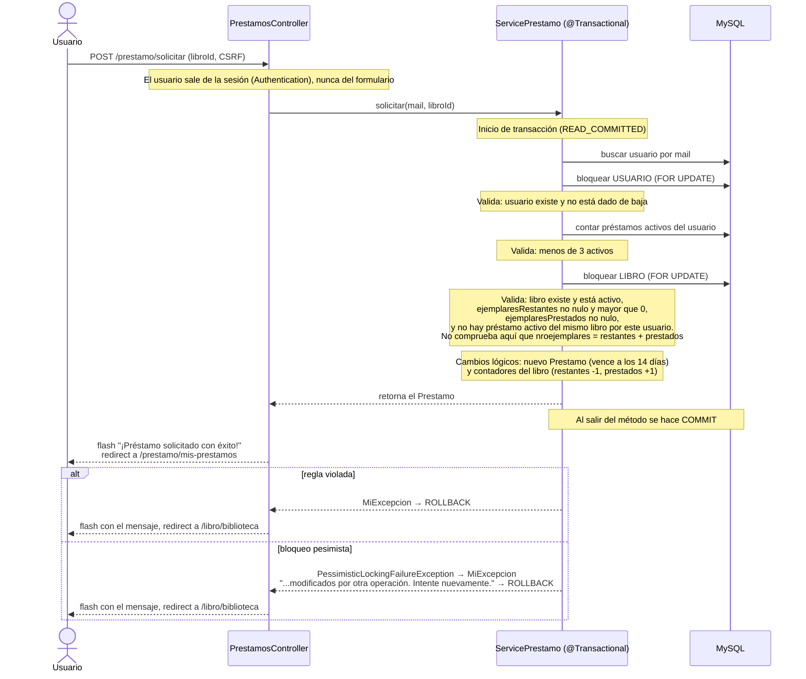
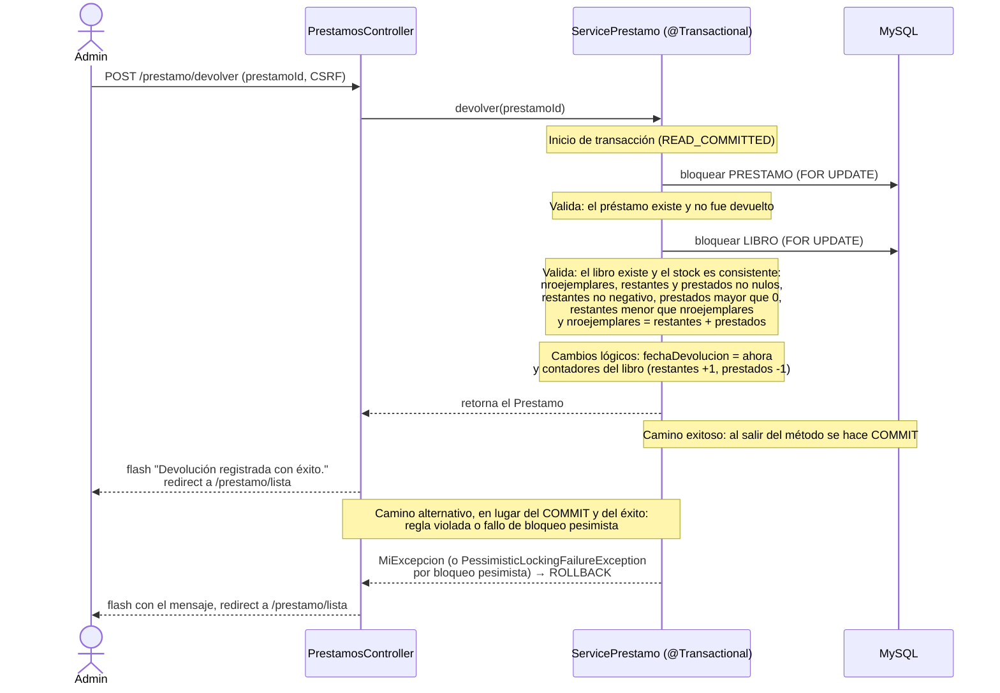
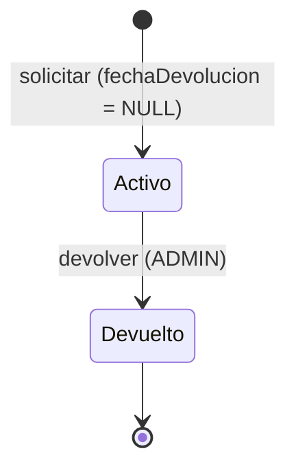

# Diagramas — Librería Web El Ceibo

## 1. Capas

## 2. Entidades y restricciones

Cardinalidades y restricciones contrastadas con las entidades JPA y con las migraciones V1–V4:

Restricción adicional de V3: `UK_libro_titulo_autor` sobre (`titulo`, `autor_id`).

## 3. Solicitud de préstamo (USUARIO)

Las validaciones aparecen en su posición real respecto de cada bloqueo. Las líneas de
cambio (`INSERT`/`UPDATE`) representan **cambios lógicos dentro de la transacción**: no
indican el orden exacto del SQL que emite Hibernate.

## 4. Devolución (ADMIN)

## 5. Estados del préstamo

## Notas y límites

- **Estado de los diagramas:** revisados por lectura contra las entidades JPA, las migraciones V1–V4, `ServicePrestamo` y `PrestamosController`. Los cinco diagramas se renderizaron e inspeccionaron visualmente en local (28/10/2026) con las notas actuales de los diagramas 3 y 4. **La comprobación del renderizado en GitHub sigue pendiente.**
- **Fallos de bloqueo:** solo `ServicePrestamo` y `ServiceLibro` capturan `PessimisticLockingFailureException`; `ServiceAutor`, `ServiceEditorial`, `ServicePortada` y `ServiceUsuario` no tienen esa captura.
- **Cardinalidades:** `PORTADA |o--o| LIBRO` refleja la restricción `UNIQUE` de `portada_id` (V3), con ambos lados opcionales.
- **Cobertura de pruebas de catálogo y portadas:** los tests comprueban que las altas, bajas y eliminaciones no mutan por GET y sí por POST con CSRF, las reglas de catálogo y de usuarios, la concurrencia de catálogo y la descarga de portadas creadas por fixture. Ningún test sube por HTTP un archivo de portada con contenido; el único test multipart envía una parte `archivo` vacía con datos inválidos. Alta, modificación, baja y eliminación, y la carga de portadas, se validaron por HTTP contra el JAR del clon de `fdedf95` (sesión `ADMIN`, base demo; ver README, sección Tests), no con navegador.
- Si cambian `ServicePrestamo` o `PrestamosController`, repetir el contraste de las secuencias 3 y 4.
